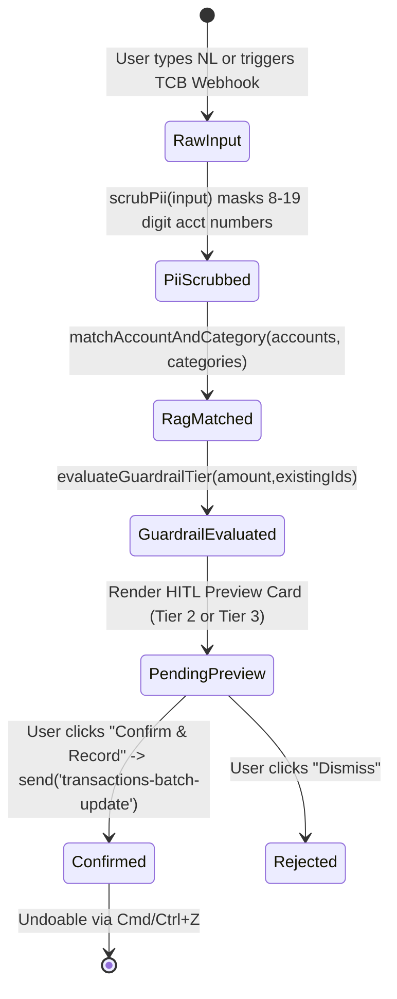

# Phase 1 Data Model: UXDA Financial Workspace & AI Copilot

**Feature**: `001-uxda-ai-financial-copilot`
**Date**: 2026-11-07

## 1. Core Entities & TypeScript Interfaces

All entities reside in `packages/desktop-client/src/components/ai-copilot/copilotTypes.ts` and strictly adhere to `typescript-strict-plugin` (zero `@ts-strict-ignore`, exact `IntegerAmount`).

### 1.1 `GuardrailTier`

```ts
export type GuardrailTier = 1 | 2 | 3;
```

- `1`: **Read-Only Analytics** (auto-executed, zero state mutation).
- `2`: **Scoped Single-Record Write** (within sanity cap `|amount| <= 20,000,000` major units, deterministic `imported_id`, requires 1-click user confirmation).
- `3`: **High-Value / Bulk Mutation** (exceeds sanity cap `|amount| > 20,000,000` major units, displays prominent HITL warning banner before confirmation).

### 1.2 `CopilotTransactionProposal`

Represents a validated, PII-scrubbed transaction ready for Human-in-the-Loop confirmation and `transactions-batch-update` execution.

| Field              | Type                                                    | Constraints                           | Description                                           |
| :----------------- | :------------------------------------------------------ | :------------------------------------ | :---------------------------------------------------- |
| `id`               | `string`                                                | Required, UUID/hash                   | Ephemeral proposal ID in UI                           |
| `source`           | `'copilot-nl' \| 'techcombank-webhook'`                 | Required                              | Origin of the transaction                             |
| `rawInput`         | `string`                                                | Required                              | Original user input or webhook summary                |
| `scrubbedInput`    | `string`                                                | Required, PII redacted                | Input after redacting `\b\d{8,19}\b`, emails, phones  |
| `piiRedactedCount` | `number`                                                | `>= 0`                                | Number of sensitive tokens scrubbed                   |
| `accountId`        | `string`                                                | Required, valid `AccountEntity['id']` | Target Actual account ID                              |
| `accountName`      | `string`                                                | Required                              | Matched account display name                          |
| `categoryId`       | `string \| null`                                        | Nullable `CategoryEntity['id']`       | Matched budget category ID                            |
| `categoryName`     | `string`                                                | Required                              | Matched category display name                         |
| `payeeName`        | `string`                                                | Required, non-empty                   | Extracted payee or merchant name                      |
| `amount`           | `IntegerAmount`                                         | Required, exact integer minor units   | Negative for expense, positive for income             |
| `date`             | `string`                                                | Required, `YYYY-MM-DD`                | Transaction date (defaults to today)                  |
| `notes`            | `string`                                                | Required                              | Formatted audit note (`[AI Copilot]` or `[TCB Sync]`) |
| `importedId`       | `string`                                                | Required, deterministic               | `ai:copilot:<hash>` or `tcb:<ref>:<date>:<amount>`    |
| `guardrailTier`    | `GuardrailTier`                                         | `2 \| 3`                              | Evaluated security tier                               |
| `guardrailReason`  | `string`                                                | Required                              | Human-readable explanation of the tier classification |
| `status`           | `'pending' \| 'confirmed' \| 'rejected' \| 'duplicate'` | Required                              | Lifecycle state of the proposal                       |

### 1.3 `TechcombankWebhookPayload`

Represents an incoming Techcombank notification payload (compatible with Casso / SePay / iOS Shortcuts).

| Field               | Type     | Constraints                     | Description                                                              |
| :------------------ | :------- | :------------------------------ | :----------------------------------------------------------------------- |
| `referenceId`       | `string` | Required (e.g. `FT26311982341`) | Bank transaction reference ID                                            |
| `transactionDate`   | `string` | `YYYY-MM-DD`                    | Date of bank settlement                                                  |
| `amountVnd`         | `number` | Non-zero integer                | Signed amount in VND (e.g., `-55000` or `25000000`)                      |
| `description`       | `string` | Required                        | Raw bank remark (e.g., `NGUYEN VAN A chuyen tien an pho 19038475629102`) |
| `accountNumberHint` | `string` | Optional                        | Last 4 digits or account alias                                           |

## 2. State Transitions


